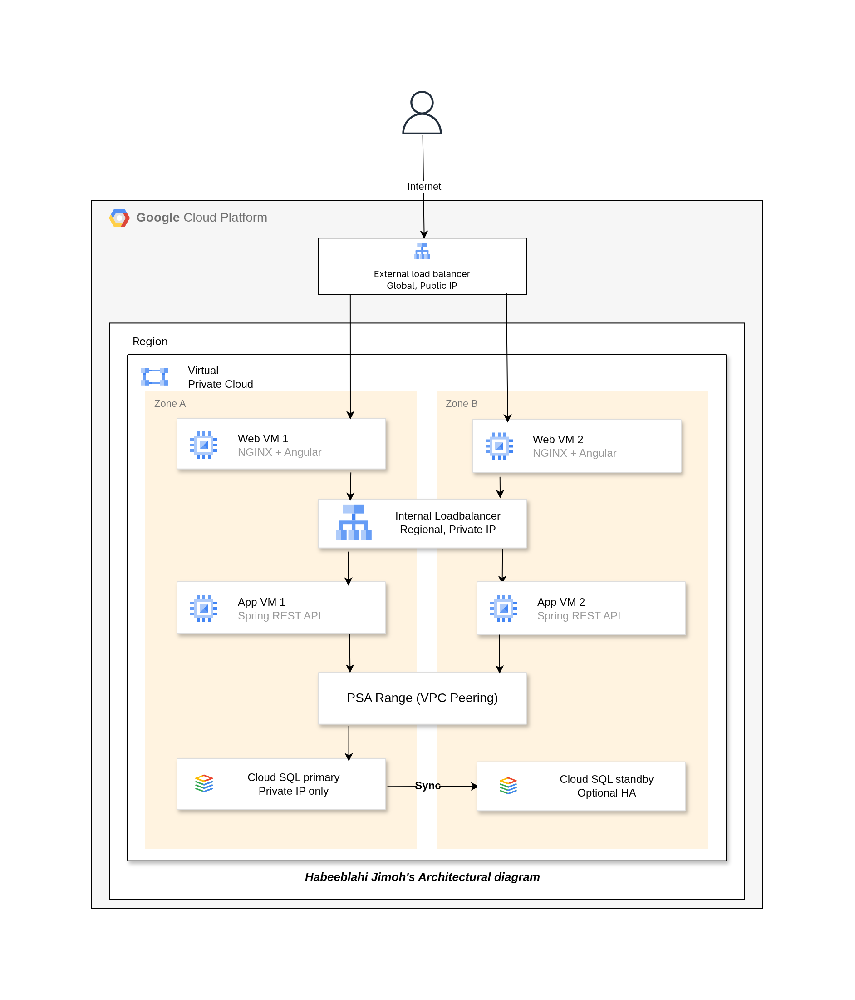
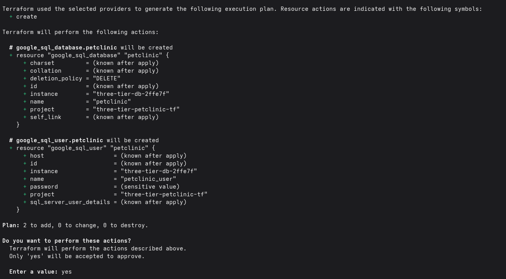

# GCP three-tier Petclinic

Web (NGINX + Angular) -> internal load balancer -> app (Spring Boot) -> Cloud SQL (PostgreSQL), region europe-west1.

## Architecture

## Layout
- `app/`  Spring Petclinic REST API source and Dockerfile
- `web/`  Spring Petclinic Angular source, Dockerfile, NGINX config template
- `scripts/` image build/push and VM startup scripts
- `infra/` Terraform
- `docs/` diagram and screenshots

## Terraform progress

This screenshot captures an early Terraform apply while creating the GCP database resource:

## Credits
`app/` and `web/` come from spring-petclinic/spring-petclinic-rest and spring-petclinic/spring-petclinic-angular (Apache 2.0).
